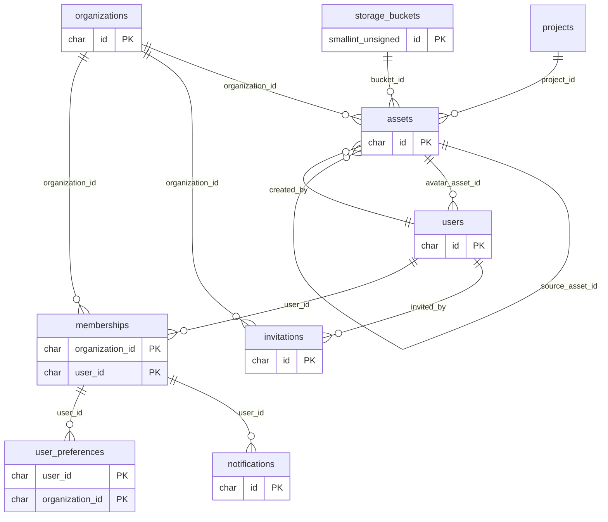
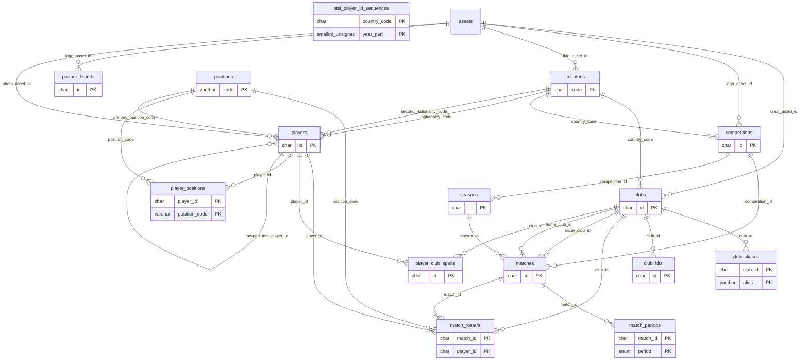
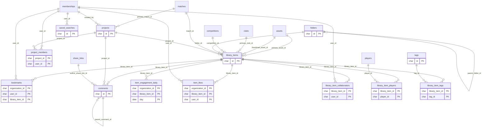
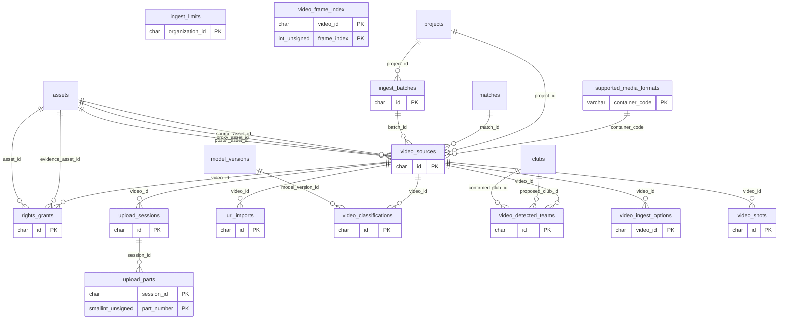
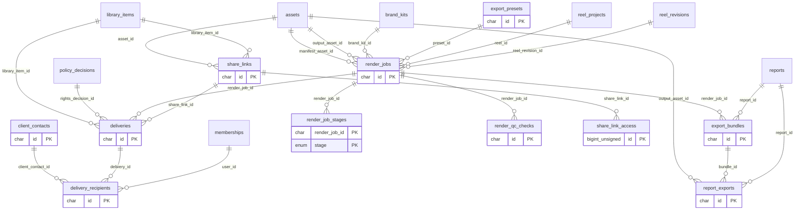

# OTSI VIE — Entity Relationship Diagrams (Mermaid, generated from live FKs)

One diagram per module; cross-module references are drawn to the referenced entity. Render in GitHub, VS Code (Markdown Preview Mermaid) or mermaid.live.

## 001_foundation_identity_storage

## 002_reference_registry_matches

## 003_projects_library_collaboration

## 004_media_ingest_rights

## 005_pipeline_cv_identity

```mermaid
erDiagram
  detection_batches {
    char id PK
  }
  evidence_records {
    char id PK
  }
  identity_review_tasks {
    char id PK
  }
  job_log_entries {
    bigint_unsigned id PK
  }
  model_evaluation_runs {
    char id PK
  }
  model_evaluation_sets {
    char id PK
  }
  model_versions {
    char id PK
  }
  pipeline_preview_frames {
    char id PK
  }
  pipeline_runs {
    char id PK
  }
  pipeline_stage_definitions {
    varchar code PK
  }
  pipeline_step_segments {
    bigint_unsigned id PK
  }
  pipeline_steps {
    char id PK
  }
  pitch_calibrations {
    char id PK
  }
  presence_intervals {
    char id PK
  }
  run_worker_assignments {
    char run_id PK
    char worker_id PK
    varchar stage_code PK
  }
  track_gaps {
    char id PK
  }
  track_identity_candidates {
    char id PK
  }
  track_identity_decisions {
    char id PK
  }
  track_observations {
    char video_id PK
    int_unsigned frame_index PK
    char track_id PK
  }
  track_segments {
    char id PK
  }
  tracks {
    char id PK
  }
  worker_nodes {
    char id PK
  }
  worker_resource_samples {
    char worker_id PK
    datetime sampled_at PK
  }
  assets ||--o{ detection_batches : "payload_asset_id"
  assets ||--o{ pipeline_preview_frames : "frame_asset_id"
  assets ||--o{ pipeline_steps : "output_asset_id"
  assets ||--o{ track_segments : "observation_asset_id"
  evidence_records ||--o{ track_identity_decisions : "evidence_id"
  matches ||--o{ track_identity_candidates : "match_id"
  model_evaluation_sets ||--o{ model_evaluation_runs : "evaluation_set_id"
  model_versions ||--o{ detection_batches : "model_version_id"
  model_versions ||--o{ evidence_records : "model_version_id"
  model_versions ||--o{ model_evaluation_runs : "model_version_id"
  model_versions ||--o{ pipeline_steps : "model_version_id"
  model_versions ||--o{ pitch_calibrations : "model_version_id"
  model_versions ||--o{ track_identity_candidates : "model_version_id"
  pipeline_runs ||--o{ detection_batches : "run_id"
  pipeline_runs ||--o{ evidence_records : "pipeline_run_id"
  pipeline_runs ||--o{ job_log_entries : "run_id"
  pipeline_runs ||--o{ pipeline_preview_frames : "run_id"
  pipeline_runs ||--o{ pipeline_runs : "retry_of_run_id"
  pipeline_runs ||--o{ pipeline_steps : "run_id"
  pipeline_runs ||--o{ run_worker_assignments : "run_id"
  pipeline_runs ||--o{ tracks : "run_id"
  pipeline_stage_definitions ||--o{ pipeline_steps : "stage_code"
  pipeline_stage_definitions ||--o{ run_worker_assignments : "stage_code"
  pipeline_steps ||--o{ job_log_entries : "step_id"
  pipeline_steps ||--o{ pipeline_step_segments : "step_id"
  players ||--o{ track_identity_candidates : "player_id"
  players ||--o{ track_identity_decisions : "player_id"
  players ||--o{ tracks : "current_player_id"
  track_identity_decisions ||--o{ identity_review_tasks : "resolution_decision_id"
  track_identity_decisions ||--o{ track_identity_decisions : "supersedes_id"
  track_identity_decisions ||--o{ tracks : "current_decision_id"
  tracks ||--o{ identity_review_tasks : "track_id"
  tracks ||--o{ presence_intervals : "track_id"
  tracks ||--o{ track_gaps : "track_id"
  tracks ||--o{ track_identity_candidates : "track_id"
  tracks ||--o{ track_identity_decisions : "track_id"
  tracks ||--o{ track_segments : "track_id"
  video_shots ||--o{ pitch_calibrations : "shot_id"
  video_shots ||--o{ track_segments : "shot_id"
  video_sources ||--o{ evidence_records : "video_id"
  video_sources ||--o{ identity_review_tasks : "video_id"
  video_sources ||--o{ pipeline_runs : "video_id"
  video_sources ||--o{ pitch_calibrations : "video_id"
  video_sources ||--o{ presence_intervals : "video_id"
  video_sources ||--o{ tracks : "video_id"
  worker_nodes ||--o{ run_worker_assignments : "worker_id"
  worker_nodes ||--o{ worker_resource_samples : "worker_id"
```

## 006_events_metrics_tactics

```mermaid
erDiagram
  cohort_metric_baselines {
    char cohort_id PK
    varchar metric_key PK
  }
  event_candidates {
    char id PK
  }
  event_decisions {
    char id PK
  }
  event_types {
    varchar code PK
  }
  heatmaps {
    char id PK
  }
  metric_cohorts {
    char id PK
  }
  metric_definitions {
    varchar metric_key PK
  }
  metric_values {
    char id PK
  }
  movement_segments {
    char id PK
  }
  pass_network_edges {
    char network_id PK
    varchar from_node_key PK
    varchar to_node_key PK
  }
  pass_network_nodes {
    char network_id PK
    varchar node_key PK
  }
  pass_networks {
    char id PK
  }
  possession_episodes {
    char id PK
  }
  tactical_windows {
    char id PK
  }
  team_shape_nodes {
    char snapshot_id PK
    tinyint_unsigned slot_no PK
  }
  team_shape_snapshots {
    char id PK
  }
  assets ||--o{ event_candidates : "clip_asset_id"
  assets ||--o{ heatmaps : "image_asset_id"
  event_candidates ||--o{ event_decisions : "event_id"
  event_types ||--o{ event_candidates : "event_type"
  event_types ||--o{ event_decisions : "revised_type"
  evidence_records ||--o{ event_candidates : "evidence_id"
  evidence_records ||--o{ metric_values : "evidence_id"
  matches ||--o{ event_candidates : "match_id"
  matches ||--o{ metric_values : "match_id"
  metric_cohorts ||--o{ cohort_metric_baselines : "cohort_id"
  metric_definitions ||--o{ cohort_metric_baselines : "metric_key"
  metric_definitions ||--o{ metric_values : "metric_key"
  model_versions ||--o{ event_candidates : "model_version_id"
  model_versions ||--o{ metric_values : "model_version_id"
  pass_network_nodes ||--o{ pass_network_edges : "from_node_key"
  pass_network_nodes ||--o{ pass_network_edges : "to_node_key"
  pass_networks ||--o{ pass_network_nodes : "network_id"
  pipeline_runs ||--o{ event_candidates : "run_id"
  pipeline_runs ||--o{ metric_values : "run_id"
  pipeline_runs ||--o{ possession_episodes : "run_id"
  pipeline_runs ||--o{ tactical_windows : "run_id"
  pipeline_runs ||--o{ team_shape_snapshots : "run_id"
  pitch_calibrations ||--o{ event_candidates : "calibration_id"
  pitch_calibrations ||--o{ movement_segments : "calibration_id"
  pitch_calibrations ||--o{ team_shape_snapshots : "calibration_id"
  players ||--o{ event_candidates : "primary_player_id"
  players ||--o{ event_candidates : "secondary_player_id"
  players ||--o{ heatmaps : "player_id"
  players ||--o{ metric_values : "player_id"
  players ||--o{ movement_segments : "player_id"
  players ||--o{ pass_network_nodes : "player_id"
  players ||--o{ possession_episodes : "player_id"
  players ||--o{ team_shape_nodes : "player_id"
  team_shape_snapshots ||--o{ team_shape_nodes : "snapshot_id"
  tracks ||--o{ event_candidates : "primary_track_id"
  tracks ||--o{ event_candidates : "secondary_track_id"
  tracks ||--o{ metric_values : "track_id"
  tracks ||--o{ movement_segments : "track_id"
  tracks ||--o{ team_shape_nodes : "track_id"
  video_sources ||--o{ event_candidates : "video_id"
  video_sources ||--o{ heatmaps : "video_id"
  video_sources ||--o{ metric_values : "video_id"
  video_sources ||--o{ movement_segments : "video_id"
  video_sources ||--o{ pass_networks : "video_id"
  video_sources ||--o{ possession_episodes : "video_id"
  video_sources ||--o{ tactical_windows : "video_id"
  video_sources ||--o{ team_shape_snapshots : "video_id"
```

## 007_reels_spotlight_studio

```mermaid
erDiagram
  brand_kits {
    char id PK
  }
  caption_cues {
    char id PK
  }
  effect_keyframes {
    char id PK
  }
  effect_presets {
    char id PK
  }
  media_clip_tags {
    char clip_id PK
    char tag_id PK
  }
  media_clips {
    char id PK
  }
  moment_suggestions {
    char id PK
  }
  music_tracks {
    char id PK
  }
  reel_chapters {
    char id PK
  }
  reel_clips {
    char id PK
  }
  reel_projects {
    char id PK
  }
  reel_revisions {
    char id PK
  }
  reel_settings_flags {
    char reel_id PK
  }
  reel_style_settings {
    char reel_id PK
  }
  reel_targets {
    char reel_id PK
    char player_id PK
  }
  timeline_items {
    char id PK
  }
  timeline_tracks {
    char id PK
  }
  assets ||--o{ brand_kits : "font_asset_id"
  assets ||--o{ brand_kits : "intro_asset_id"
  assets ||--o{ brand_kits : "logo_asset_id"
  assets ||--o{ brand_kits : "outro_asset_id"
  assets ||--o{ brand_kits : "watermark_asset_id"
  assets ||--o{ media_clips : "clip_asset_id"
  assets ||--o{ media_clips : "thumbnail_asset_id"
  assets ||--o{ moment_suggestions : "thumbnail_asset_id"
  assets ||--o{ music_tracks : "audio_asset_id"
  assets ||--o{ music_tracks : "waveform_asset_id"
  assets ||--o{ reel_chapters : "thumbnail_asset_id"
  assets ||--o{ timeline_items : "asset_id"
  brand_kits ||--o{ reel_projects : "brand_kit_id"
  effect_presets ||--o{ reel_style_settings : "spotlight_preset_id"
  effect_presets ||--o{ timeline_items : "effect_preset_id"
  event_candidates ||--o{ media_clips : "event_id"
  event_candidates ||--o{ moment_suggestions : "event_id"
  event_candidates ||--o{ reel_clips : "source_event_id"
  event_types ||--o{ media_clips : "event_type"
  folders ||--o{ media_clips : "folder_id"
  matches ||--o{ media_clips : "match_id"
  matches ||--o{ reel_projects : "match_id"
  media_clips ||--o{ media_clip_tags : "clip_id"
  media_clips ||--o{ reel_clips : "media_clip_id"
  metric_values ||--o{ timeline_items : "metric_value_id"
  model_versions ||--o{ moment_suggestions : "model_version_id"
  moment_suggestions ||--o{ reel_clips : "moment_suggestion_id"
  music_tracks ||--o{ reel_projects : "music_track_id"
  players ||--o{ media_clips : "player_id"
  players ||--o{ reel_targets : "player_id"
  projects ||--o{ reel_projects : "project_id"
  reel_clips ||--o{ timeline_items : "reel_clip_id"
  reel_projects ||--o{ moment_suggestions : "reel_id"
  reel_projects ||--o{ reel_chapters : "reel_id"
  reel_projects ||--o{ reel_clips : "reel_id"
  reel_projects ||--o{ reel_revisions : "reel_id"
  reel_projects ||--o{ reel_settings_flags : "reel_id"
  reel_projects ||--o{ reel_style_settings : "reel_id"
  reel_projects ||--o{ reel_targets : "reel_id"
  reel_projects ||--o{ timeline_tracks : "reel_id"
  tags ||--o{ media_clip_tags : "tag_id"
  timeline_items ||--o{ caption_cues : "timeline_item_id"
  timeline_items ||--o{ effect_keyframes : "timeline_item_id"
  timeline_tracks ||--o{ timeline_items : "timeline_track_id"
  track_identity_decisions ||--o{ reel_targets : "identity_decision_id"
  tracks ||--o{ reel_targets : "primary_track_id"
  video_sources ||--o{ media_clips : "source_video_id"
  video_sources ||--o{ moment_suggestions : "video_id"
  video_sources ||--o{ reel_clips : "source_video_id"
  video_sources ||--o{ reel_projects : "video_id"
```

## 008_reports_scouting

```mermaid
erDiagram
  player_notes {
    char id PK
  }
  player_role_profiles {
    char id PK
  }
  player_role_traits {
    char profile_id PK
    varchar trait_label PK
  }
  report_identity_confidence {
    char report_id PK
  }
  report_insight_citations {
    char insight_id PK
    tinyint_unsigned citation_no PK
  }
  report_insights {
    char id PK
  }
  report_metric_snapshots {
    char report_id PK
    enum block PK
    varchar metric_key PK
  }
  reports {
    char id PK
  }
  scouting_assessments {
    char id PK
  }
  scouting_dossier_items {
    char dossier_id PK
    char player_id PK
  }
  scouting_dossiers {
    char id PK
  }
  scouting_strengths {
    char assessment_id PK
    tinyint_unsigned display_order PK
  }
  event_candidates ||--o{ report_insight_citations : "event_id"
  folders ||--o{ scouting_dossiers : "folder_id"
  matches ||--o{ reports : "match_id"
  memberships ||--o{ player_notes : "author_id"
  memberships ||--o{ scouting_assessments : "scout_user_id"
  metric_cohorts ||--o{ report_insight_citations : "cohort_id"
  metric_cohorts ||--o{ reports : "cohort_id"
  metric_definitions ||--o{ report_metric_snapshots : "metric_key"
  metric_values ||--o{ report_insight_citations : "metric_value_id"
  metric_values ||--o{ report_metric_snapshots : "source_metric_value_id"
  model_versions ||--o{ report_insights : "model_version_id"
  player_role_profiles ||--o{ player_role_traits : "profile_id"
  players ||--o{ player_notes : "player_id"
  players ||--o{ player_role_profiles : "player_id"
  players ||--o{ reports : "player_id"
  players ||--o{ scouting_assessments : "player_id"
  players ||--o{ scouting_dossier_items : "player_id"
  projects ||--o{ reports : "project_id"
  report_insights ||--o{ report_insight_citations : "insight_id"
  reports ||--o{ player_role_profiles : "report_id"
  reports ||--o{ report_identity_confidence : "report_id"
  reports ||--o{ report_insights : "report_id"
  reports ||--o{ report_metric_snapshots : "report_id"
  reports ||--o{ scouting_assessments : "report_id"
  reports ||--o{ scouting_dossier_items : "report_id"
  scouting_assessments ||--o{ scouting_strengths : "assessment_id"
  scouting_dossiers ||--o{ scouting_dossier_items : "dossier_id"
  video_sources ||--o{ reports : "video_id"
```

## 009_render_export_delivery

## 010_commercial_governance_ops

```mermaid
erDiagram
  admin_actions {
    char id PK
  }
  artifact_dependencies {
    char artifact_asset_id PK
    char depends_on_asset_id PK
    enum dependency_type PK
  }
  audit_events {
    bigint_unsigned id PK
    datetime occurred_at PK
  }
  billing_customers {
    char id PK
  }
  billing_webhook_inbox {
    bigint_unsigned id PK
  }
  entitlement_grants {
    char id PK
  }
  idempotency_keys {
    char organization_id PK
    varchar idempotency_key PK
  }
  invoices {
    char id PK
  }
  kpi_snapshots {
    char organization_id PK
    enum kpi_key PK
    enum period_kind PK
  }
  outbox_events {
    bigint_unsigned id PK
  }
  plan_prices {
    char id PK
  }
  plan_versions {
    char id PK
  }
  plans {
    char id PK
  }
  policy_decisions {
    char id PK
  }
  processing_dead_letters {
    char id PK
  }
  quota_counters {
    char organization_id PK
    varchar feature_key PK
    datetime window_start PK
  }
  quota_reservations {
    char id PK
  }
  release_signoffs {
    char id PK
  }
  retention_jobs {
    char id PK
  }
  schema_migrations {
    varchar version PK
  }
  security_events {
    bigint_unsigned id PK
  }
  subscriptions {
    char id PK
  }
  usage_events {
    char id PK
  }
  assets ||--o{ artifact_dependencies : "artifact_asset_id"
  assets ||--o{ artifact_dependencies : "depends_on_asset_id"
  plan_versions ||--o{ plan_prices : "plan_version_id"
  plan_versions ||--o{ subscriptions : "plan_version_id"
  plans ||--o{ plan_versions : "plan_id"
  quota_counters ||--o{ quota_reservations : "window_start"
  quota_reservations ||--o{ usage_events : "reservation_id"
  subscriptions ||--o{ entitlement_grants : "source_subscription_id"
  subscriptions ||--o{ invoices : "subscription_id"
```

Note: `users` and `organizations` edges are omitted outside module 001 for legibility; every tenant table carries `organization_id`.