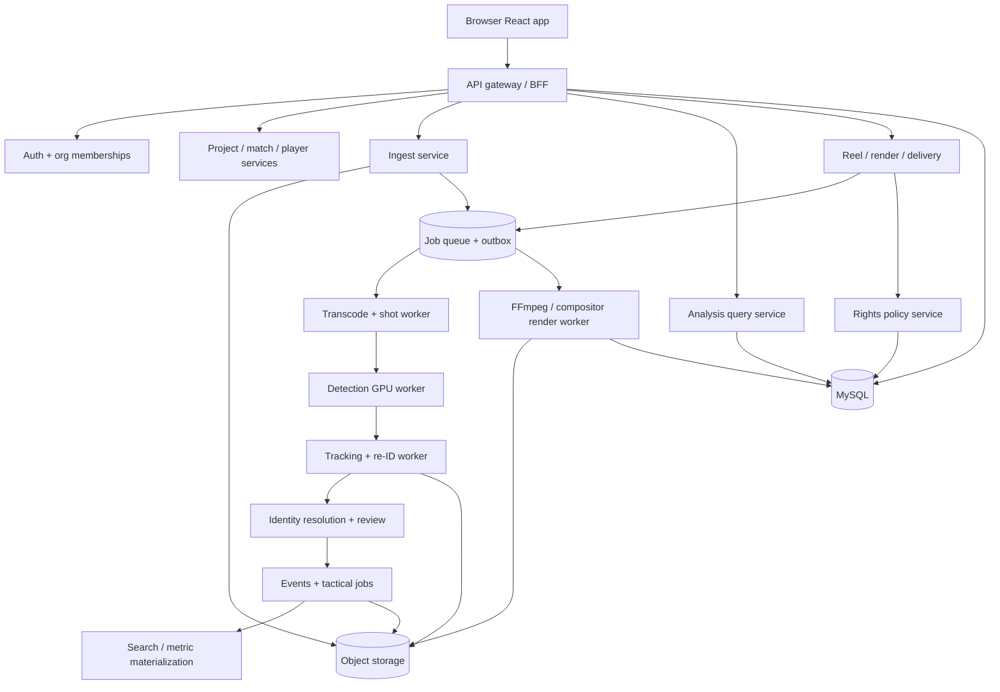

> Adapted architectural reference only. MySQL migration authority is in `01_COMMERCIAL_MASTER_BLUEPRINT/mysql_migrations/`. Do not assume a described control is implemented or tested.

# System architecture: service boundaries, dependencies, data ownership

## System context
Actors: organization owner, analyst, editor, scout, reviewer, viewer, external client, system worker. Inputs: authorized match footage via resumable browser upload / signed direct-upload parts; direct-downloadable allowed URL; roster/club metadata from existing OTSI registry; operator annotations; optional external event metadata under valid commercial license. Outputs: synchronized detection overlays, uncertainty-labeled identities/events, editable reel projects, rights-cleared MP4s, PDF/CSV/PNG artifacts, share URLs, append-only audit.

## Reference topology

All long work is queued; browser uses job updates via authenticated SSE or WebSockets and resumable polling fallback. Workers share contracts, not DB table writes across arbitrary domains.

## Deployable modules and database owners
| Module | Responsibilities | Authoritative tables | API prefix | Queue |
|---|---|---|---|---|
| Identity / access | SSO OIDC, sessions, org membership, role checks | organizations/users/memberships | `/auth`, `/organizations` | audit |
| Registry adapter | Read existing canonical player IDs; roster matching; preserve web allocator | players/clubs/match_rosters | `/players`, `/matches` | registry-sync |
| Projects | projects, library, tags, collaboration | projects/assets/comments | `/projects`, `/library` | index |
| Media ingestion | upload, validate, probe, hash, transcode, shot map | video_sources/assets/video_frame_index | `/uploads`, `/videos` | ingest |
| CV inference | class detection, ball, segmentation optional | detection_batches, model_versions | `/analysis/runs` | detect |
| Tracker | temporal association, tracklets, dense observation chunks | tracks/track_segments/track_observations | `/tracks` | track |
| Identity | OCR/team context/candidate ranking/review | track_identity_candidates/decisions | `/identity` | identity |
| Game intelligence | events, pitch calibration, off-ball/tactical metrics | event_candidates/decisions, pitch_calibrations, metric_values | `/events`, `/metrics`, `/tactics` | intelligence |
| Reel production | target selection, clip specs, editable timeline, styles | reel_projects/reel_targets/reel_clips/timeline_* | `/reels` | preview/render |
| Artifact output | manifest, encode, quality verification | render_jobs/report_jobs/assets | `/renders`, `/reports` | render/report |
| Rights and delivery | rights grant, produce/export decisions, share links | rights_grants/share_links/deliveries/audit_events | `/rights`, `/deliveries`, `/shares` | dispatch |

## Recommended technology choices (substitution requires ADR)
- Web: TypeScript, React, accessible component toolkit, React Query/TanStack for server cache; Zustand or equivalent for ephemeral workspace state, web-video canvas/WebGL overlays and timeline virtualization. Browser renders **visualization only**, not authoritative tracking.
- API: Python FastAPI or TypeScript NestJS; favor typed OpenAPI DTO generation, worker compatibility, and clear service boundaries. Python for CV worker where required, independent of API language.
- Database: MySQL 8.4 LTS relational transactional store; Redis for transient caches/queues locks; durable outbox + broker such as RabbitMQ or SQS for jobs, explicitly chosen during ADR. Keep Redis alone out of sole durable job authority unless guarantees proved.
- Media: S3-compatible versioned object store, CDN for rights-checked playback, ffprobe/FFmpeg normalization, HLS for browser playback and MP4 deliverables; extracted high volume arrays in immutable Parquet.
- CV: pluggable detector and tracker, supervised calibration/evaluation; model versions pinned, license assessed for every library/weights/dataset before commercial use.
- Observability: OpenTelemetry distributed traces, metric exporters, structured event log, alerting, GPU telemetry and failed job dashboard.

## Runtime boundaries
**Hot path** video playback requests retrieve proxies/HLS from authorized URLs; overlay chunks fetched by `video_id`, `run_id`, shot/PTS window, synchronized in browser with decoded media clock. **Cold path** GPU processing runs asynchronously; render jobs produce MP4+manifest, object storage atomic publication after QA. **Control plane** governs access, rights, identities and job states.

## Consistency contracts
- Use transaction + outbox when creating durable jobs. Queue consumers are at-least-once and must be idempotent by `job_id`, `step`, input hash and model/pipeline version.
- Video reanalysis makes a new immutable `pipeline_run`; never mutate historical run's observations to imply same result.
- Report and reel jobs pin model/run/track identity decision IDs to prevent silent drift after later corrections.
- Default `readiness=false` until QC+rights+identity checks pass; no success badges based just on queue completion.
- No blind external provider URL scraping; explicit importer adapter with authorization, quota, terms, and SSRF protection.

## Interface/API versioning
REST `/api/v1`, JSON in snake_case or camelCase **once defined consistently**; published OpenAPI generated from server code; messages carry `schema_version`, request ID, cursor and `run_id` where applicable. Breaking changes add `/v2` and migration compatibility tests. Playback overlay schema is independently versioned.

## Production readiness evidence
The architect/developer must provide ADR files for language/stack, GPU provisioning, commercial model/dataset licenses, storage lifecycle, AI KPI thresholds from a curated eval set, API authentication provider, supported browser/device matrix and backup objectives. No UI-suggested confidence/accuracy/performance number is accepted without measurement.
